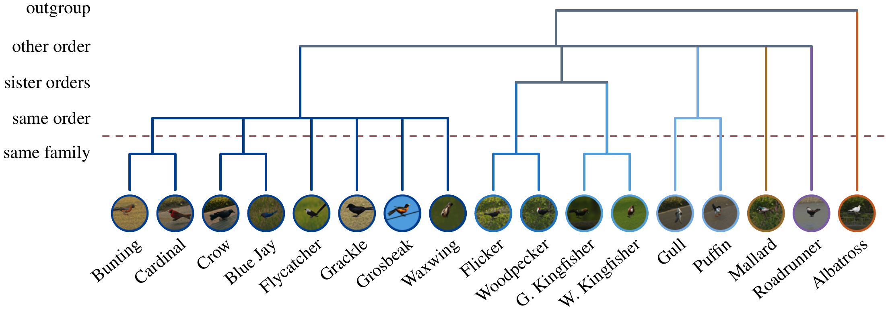

<div align="center">

# Beyond Family Labels: A Taxonomic Ornstein–Uhlenbeck Prior for Avian 3D Shape Recovery

**NeurIPS 2026 (Oral)**

Yunchan Jeon<sup>1\*</sup>, SooGon Kim<sup>1\*</sup>, Seungwook Kim<sup>2</sup>, CheolWon Lee<sup>3</sup>, Jongmin Lee<sup>1†</sup>

<sup>1</sup>Chung-Ang University &nbsp; <sup>2</sup>GenGenAI &nbsp; <sup>3</sup>Konkuk University &nbsp;&nbsp; <sup>\*</sup>Equal contribution &nbsp; <sup>†</sup>Corresponding author

[](https://openreview.net/forum?id=WHGRxkYCGV)
[](https://huggingface.co/rocknroll17/BFL)
[](LICENSE)



</div>

Single-image 3D bird reconstruction has to cope with a long tail: about 10,000 bird species exist,
17 of them have 3D labels, and test images often show species never seen in training.
[AniMer+](https://github.com/AniMerPlus/AniMerPlus) regularizes its AVES shape codes with a family
contrastive loss, which only knows whether two species share a family. We replace it with a
**taxonomic Ornstein–Uhlenbeck (OU) prior**: a Gaussian over the shape codes of a batch whose covariance
decays with Linnaean rank distance, `Cov(β_i, β_j) = σ²/(2α) · exp(−α · d_tax(i, j))`, with learnable
α, σ and mean μ. The family label is the α → ∞ limit of this prior, and it adds nothing at inference.

This repository is an overlay on the unmodified AniMer+ code (a git submodule). It contains the prior,
the fine-tuning and evaluation scripts, the taxonomic distance matrices, and the configuration of every
run in the paper.

## Results

Fine-tuned from the released AniMer+ checkpoint for 30K steps on CtrlAVES3D. PCK is PCK@0.1;
ours is the mean ± sample s.d. over five seeds (paper, Table 1).

| Method | CUB AUC | CUB PCK | CowBird AUC | CowBird PCK | CtrlAVES3D AUC |
|---|:-:|:-:|:-:|:-:|:-:|
| AniMer+ (TPAMI, Table VI) | 89.50 | 59.40 | 59.30 | 16.40 | 93.00 |
| **Ours** | 89.30 ± 0.02 | 57.84 ± 0.09 | **60.80 ± 0.10** | **18.86 ± 0.27** | **93.05 ± 0.01** |

CUB is the official CUB-200-2011 test split (5,794 images), CowBird the 114 annotated instances of
unseen species, CtrlAVES3D its 309-image test split.

## Installation

Tested on Ubuntu 22.04 with Python 3.10, PyTorch 2.4.0 and CUDA 12.1 (RTX 4090, RTX A5000).

```bash
git clone --recursive https://github.com/rocknroll17/BFL.git && cd BFL
conda create -n bfl python=3.10 -y && conda activate bfl
pip install torch==2.4.0 torchvision==0.19.0 --index-url https://download.pytorch.org/whl/cu121
pip install --no-build-isolation "git+https://github.com/facebookresearch/pytorch3d.git@V0.7.8"
pip install -r requirements.txt
pip install --no-build-isolation chumpy==0.70
```

AniMer+ is a git submodule (`third_party/AniMerPlus`, pinned, unmodified) and is used from source, so it
does not need to be pip-installed.

<details>
<summary><b>Docker</b></summary>

```bash
git submodule update --init                       # the image copies third_party/AniMerPlus
docker compose -f docker/docker-compose.yml up -d --build
docker compose -f docker/docker-compose.yml exec bfl bash
```

`third_party/AniMerPlus/data`, `outputs/` and `checkpoints/` are mounted from the host, so download the data
on the host (next section) or from inside the container. Requires the NVIDIA Container Toolkit.
</details>

## Data

All data is public. One script downloads it (about 23 GB after extraction) into `third_party/AniMerPlus/data/`
and builds the evaluation lists:

```bash
bash scripts/download_data.sh
python scripts/build_eval_jsons.py --verify      # optional, GPU: checks the lists against the released AniMer+ checkpoint
```

| Data | Used for | Source |
|---|---|---|
| AniMer+ checkpoint and ViT-MoE backbone | warm start | [AniMer+ release](https://github.com/AniMerPlus/AniMerPlus) |
| CtrlAVES3D (6,464 train / 309 test images, 17 species) | training, 3D evaluation | AniMer+ release |
| CUB-200-2011, official test split (5,794 images) and segmentations | 2D evaluation, seen species | [Caltech](https://www.vision.caltech.edu/datasets/cub_200_2011/) |
| CowBird, 114 annotated instances | 2D evaluation, unseen species | [Badger et al. 2020](https://github.com/marcbadger/avian-mesh) |

AniMer+ does not release its CUB and CowBird evaluation files; `scripts/build_eval_jsons.py` builds
them from the public annotations. CUB uses the official test split. The official training split is also
built (`CUB_TRAIN`); it served only as the development list for choosing λ<sub>OU</sub>.

## Checkpoints

```bash
python scripts/download_checkpoints.py          # all three, about 3.2 GB each
python scripts/download_checkpoints.py bfl      # or by name
```

| Checkpoint | Paper | CUB AUC | CUB PCK | CowBird AUC | CowBird PCK | CtrlAVES3D AUC |
|---|---|:-:|:-:|:-:|:-:|:-:|
| `bfl.pt` | Table 1 (seed 0), Table 3, Fig. 4 | 89.31 | 57.91 | 60.91 | 19.26 | 93.04 |
| `ablation/taxonomy_real.pt` | Fig. 3, Table 2 (real D<sub>tax</sub>) | 88.92 | 55.16 | 61.32 | 20.25 | 92.99 |
| `ablation/taxonomy_permuted.pt` | Fig. 3, Table 2 (permuted D<sub>tax</sub>) | 88.87 | 54.90 | 60.65 | 18.49 | 92.95 |

These are the checkpoints behind the paper's numbers; `eval.py` on an RTX 4090 reproduces them exactly.
The two ablation checkpoints were trained before seeds were fixed, so re-training does not give the same
numbers. Every other run of the paper is re-trained from its variant name (see [Training](#training)).
On other GPUs, small numerical differences can move a few CowBird keypoints across the PCK threshold
(about ±0.15 PCK on an RTX A5000).

## Evaluation

```bash
for ds in CUB COWBIRD CTRLANI3DPLUS; do
  python eval.py --ckpt checkpoints/bfl.pt --dataset $ds --out-json outputs/bfl/eval_$ds.json
done
```

`CTRLANI3DPLUS` also reports PA-MPJPE and PA-MPVPE (paper, Table 3). Scores are averaged over batches
of 16 images, as in AniMer+.

## Training

```bash
CUDA_VISIBLE_DEVICES=0 python train.py --variant table1_seed0 --out-dir outputs/table1_seed0
```

One run takes about 2 hours on an RTX 4090 (24 GB). Every run of the paper is a named variant in
[`configs/variants.yaml`](configs/variants.yaml):

| Paper | Variants | Setting |
|---|---|---|
| Table 1, Table 3, Fig. 4 | `table1_seed{0,7,21,42,123}` | λ<sub>OU</sub> = 1e-5, cosine LR |
| Fig. 4 ("no OU") | `table1_no_ou` | OU off, AniMer+'s contrastive loss on |
| Fig. 3 (Sec. 4.3), Table 2 | `sec43_real`, `sec43_permuted` | λ<sub>OU</sub> = 1e-4, constant LR, real / label-permuted D<sub>tax</sub> |
| Table 2 | `table2_family_only`, `table2_order_only` | same, coarser D<sub>tax</sub> |
| Appendix | `table1_permuted_seed*`, `sec43_*_seed*`, `lambda_*`, `k_*` | permuted controls, λ<sub>OU</sub> sweep, OU-LR multiplier |

Training on GPU is not bit-wise deterministic, so re-training a variant gives a run within the seed spread
(s.d. 0.29 CowBird PCK across the five seeds) rather than identical numbers. Re-trained with this code,
the Table 1 seeds and the Table 2 family-only / order-only runs land within 0.16 of the paper's values.

## Code overview

```
bfl/prior.py         OU covariance σ²/(2α)·exp(−α·D_tax) and its Gaussian NLL over a batch (learnable α, σ, μ)
bfl/model.py         BFLModel: AniMer+ with λ_OU · L_OU added to its training loss
bfl/datasets.py      passes the species id from AniMer+'s training data loader to the loss
train.py, eval.py    fine-tuning and evaluation
configs/             variants.yaml (every run of the paper), animerplus.yaml (model and data), datasets.yaml (evaluation sets)
data/phylogeny/      D_tax of the 17 training species (real, permuted, family-only, order-only) and its build script
scripts/             data and checkpoint download, evaluation-list builder, export to the AniMer+ layout
third_party/         AniMer+ (git submodule, unmodified)
tests/               CPU tests of the prior (python -m pytest tests)
```

To use a checkpoint with AniMer+'s own demo, convert it to their layout (the demo also needs
[detectron2](https://github.com/facebookresearch/detectron2)):

```bash
python scripts/export_checkpoint.py checkpoints/bfl.pt --out exported/bfl
cd third_party/AniMerPlus && python demo.py --checkpoint ../../exported/bfl/checkpoints/checkpoint.ckpt \
    --img_folder example_data --out_folder ../../demo_out --animal_type bird
```

## Acknowledgements

This code builds on [AniMer+](https://github.com/AniMerPlus/AniMerPlus) and the
[AVES](https://github.com/yufu-wang/aves) bird model. We thank the authors of
[CUB-200-2011](https://www.vision.caltech.edu/datasets/cub_200_2011/),
[CowBird](https://github.com/marcbadger/avian-mesh) and CtrlAVES3D for releasing their data.
The taxonomy follows the [IOC World Bird List](https://www.worldbirdnames.org/).

## Citation

```bibtex
@inproceedings{jeon2026beyond,
  title     = {Beyond Family Labels: A Taxonomic {Ornstein--Uhlenbeck} Prior for Avian {3D} Shape Recovery},
  author    = {Jeon, Yunchan and Kim, SooGon and Kim, Seungwook and Lee, CheolWon and Lee, Jongmin},
  booktitle = {Advances in Neural Information Processing Systems},
  year      = {2026}
}
```

## License

Our code is released under the [MIT License](LICENSE). AniMer+ is MIT-licensed as well; the datasets keep
their original terms.
